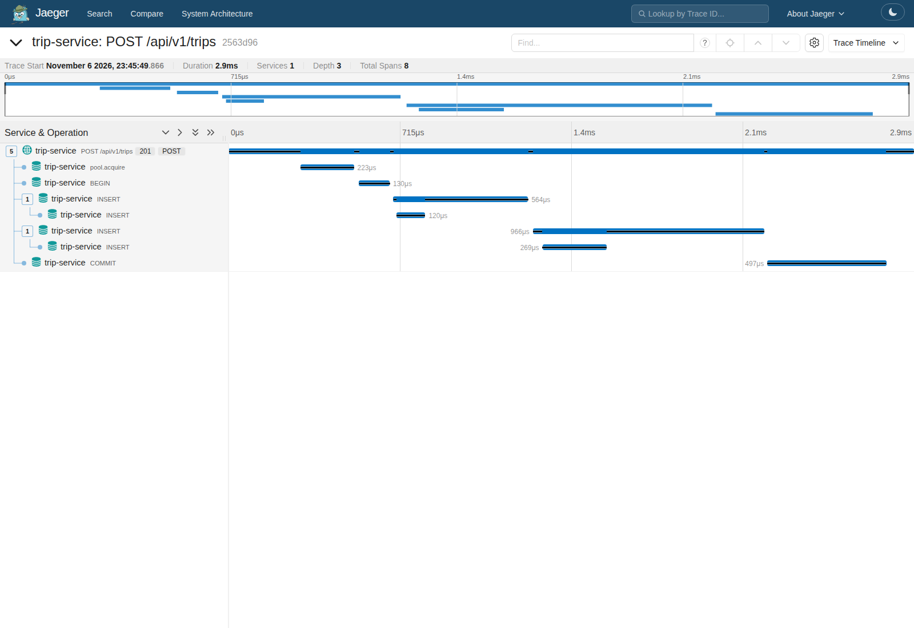
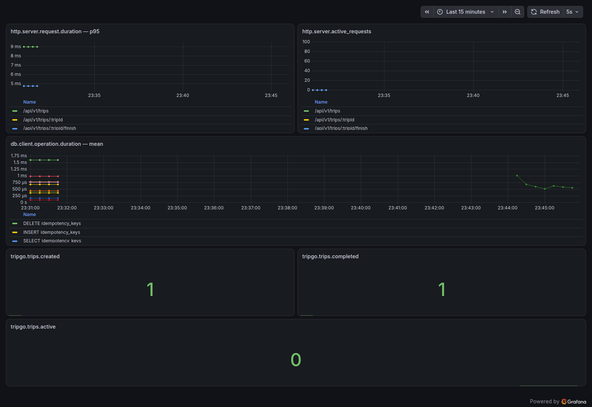

Lab 2: слои, тесты и observability

Три бизнес-ручки и контракт OpenAPI сохранены. Миграции не менялись.

Слои: HTTP → service → domain; PostgreSQL реализует интерфейсы service. Все реализации собирает `internal/container`. Интерфейсы зависимостей находятся у потребителя в `contract.go`; действия разделены на `create/get/finish`.

Решения:

- Доменные структуры и валидация остаются в `internal/domain/models`, ошибки — в `internal/domainerrors`, маппинг в Problem — в транспортном `domainerror`.
- Завершение использует `Trip.Finish`, транзакцию и `SELECT FOR UPDATE`.
- Логгер передаётся зависимостью, формат stdout — JSON. HTTP 4xx логируются как Info, 5xx — Error. Middleware реализован для Gin.
- Шесть HTTP/DB/бизнес-метрик и трейсы экспортируются по OTLP; ресурс содержит service.version. Активные поездки считаются по состоянию БД. Успешные бизнес-события учитываются после commit.

Проверки: `make lint`, `make test`, `make test-integration`, `make mutation`. Покрытие domain + service — 97,5%; мутации: до 35 убито и 16 не покрыто, после 51 убито, 0 выжило.

[Проверка лога и недоступного коллектора](observability/verification.json). [Мутационные отчёты и разбор](mutation/README.md).
